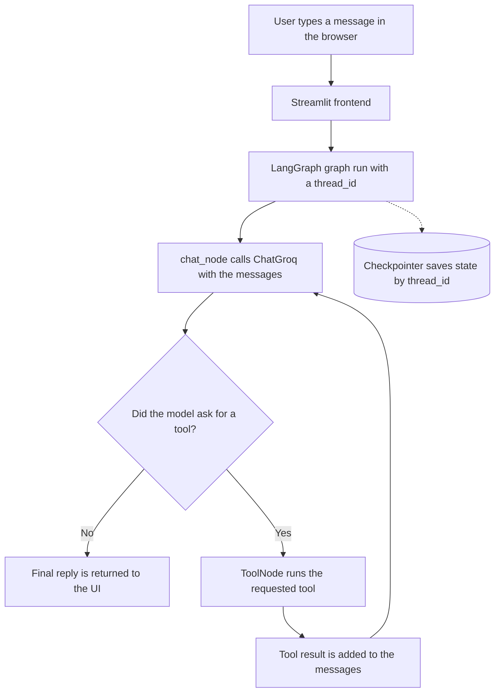
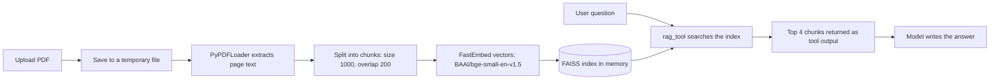

# LangGraph Chatbot


A chatbot built with Streamlit for the interface and LangGraph for the backend logic. The language model runs on Groq through LangChain's `ChatGroq`. The repo has several small app variants that each add one feature: plain chat, saved conversations, tools, PDF question answering (RAG), and MCP tools.
A Streamlit chatbot project with Groq chat inference and several LangGraph
<!-- examples: basic chat, SQLite-backed conversation threads, tool use, PDF
question answering with retrieval-augmented generation (RAG), and MCP tools.
The tool-enabled variants also include a SQLite-backed task manager. -->

## Features

- Groq chat model configured with `GROQ_API_KEY` and optional `GROQ_MODEL`.
- Search, calculator, and Alpha Vantage stock quote tools.
- Add, list, complete, and delete tasks in the current conversation.
- Separate example frontends for basic chat, streaming, SQLite history, tools,
  PDF RAG, and MCP.
- PDF text extraction and local embeddings with FastEmbed, indexed in FAISS.

## Setup

Run these commands in this project directory in PowerShell:

```powershell
py -m venv .venv
.\.venv\Scripts\Activate.ps1
python -m pip install -r requirements.txt
Copy-Item .env.example .env
```

Edit `.env` and set `GROQ_API_KEY` to your own key. Add other API keys only for
tools you plan to use. Never commit `.env` or share its contents.

## Run an app

Start one frontend at a time:

```powershell
streamlit run streamlit_frontend_tool.py
```

Other examples include `streamlit_frontend.py`,
`streamlit_frontend_database.py`, `streamlit_rag_frontend.py`, and
`streamlit_frontend_mcp.py`. See [chatbotlanggraph.txt](chatbotlanggraph.txt)
for the full project and interview guide, including each frontend's backend,
memory behavior, tools, limitations, and setup notes.

## Local data and privacy

SQLite chat checkpoints and tasks are stored in `chatbot.db` and are ignored by
Git. They remain on the machine running the app. A shared deployment needs
authentication and user-level access controls before conversation histories or
tasks can be considered private between users.

The basic in-memory example loses its conversation state when its process
stops. The RAG example's PDF vector index is also held in process memory and
must be rebuilt after a restart.


## What it can do

- Chat with a Groq-hosted model (`GROQ_API_KEY` is required, `GROQ_MODEL` is optional).
- Keep separate conversations by thread ID and reload them from SQLite.
- Stream the reply while it is being generated.
- Use tools: web search, a calculator, and an Alpha Vantage stock quote.
- Keep a task list per conversation (add, list, complete, delete).
- Answer questions from an uploaded PDF using local embeddings and a FAISS index.
- Load extra tools from MCP servers.

Only one variant runs at a time. Each frontend script imports one backend, so features are not all combined in a single app.

## How it works

Every variant follows the same basic path. The Streamlit page sends the conversation to a LangGraph graph, the graph calls the model, and the model either answers directly or asks for a tool. If a tool is requested, the result goes back to the model so it can write the final answer. This loop can repeat for more than one tool call.



The basic chat variant only has the first part: `START -> chat_node -> END`. The tool variants add the ToolNode and the routing shown above (`tools_condition` decides which way to go).

### Graph state

The state is a `TypedDict` with one field, `messages`. It uses LangGraph's `add_messages` reducer, so each step adds to the list and does not replace it. Messages are LangChain types such as `HumanMessage`, `AIMessage` and `ToolMessage`.

### PDF question answering

The RAG frontend turns an uploaded PDF into a searchable index. The retriever is exposed to the model as a tool called `rag_tool`, so the model decides when to look something up.



The temporary PDF file is deleted once indexing is done. Uploading a new PDF in a thread replaces that thread's index.

## Which file to run

Run these from the project folder. Each one starts a different example.

| Command | What it is | Backend |
| --- | --- | --- |
| `streamlit run streamlit_frontend.py` | Basic chat, fixed thread ID | `langgraph_backend.py` (InMemorySaver) |
| `streamlit run streamlit_frontend_streaming.py` | Basic chat with streamed reply | `langgraph_backend.py` |
| `streamlit run streamlit_frontend_database.py` | Saved conversations, thread list, New Chat button | `langgraph_database_backend.py` (SQLite) |
| `streamlit run streamlit_frontend_tool.py` | Search, calculator, stock quote, task manager, streaming | tool backend (SQLite) |
| `streamlit run streamlit_frontend_threading.py` | Thread selection and streaming on the tool backend | tool backend (SQLite) |
| `streamlit run streamlit_rag_frontend.py` | PDF upload plus the tools above | `langraph_rag_backend.py` |
| `streamlit run streamlit_frontend_mcp.py` | MCP tools, stock quote, task manager | `langgraph_mcp_backend.py` |

The RAG backend file is spelled `langraph_rag_backend.py` in this project. The spelling is intentional, so keep it when importing.

If you want to run two variants at once, give them different ports with `--server.port`.

## Setup

Commands below are for PowerShell on Windows.

```powershell
py -m venv .venv
.\.venv\Scripts\Activate.ps1
python -m pip install -r requirements.txt
Copy-Item .env.example .env
```

Open `.env` and set your own keys:

| Variable | Needed for |
| --- | --- |
| `GROQ_API_KEY` | Every variant |
| `GROQ_MODEL` | Optional, overrides the default model (`openai/gpt-oss-20b`) |
| `ALPHA_VANTAGE_API_KEY` | Stock quote tool |
| `MCP_MATH_SERVER_PATH` | MCP variant, path to the local math server |

The `openai/` in the default model name is just the Groq model identifier. The code only calls Groq. Model names on Groq can change, so check that the one you use is still available.

Do not commit `.env`, the `.venv` folder, or `chatbot.db`.

## Tools

**Web search.** Uses DuckDuckGo through the `ddgs` package. It needs internet access and can fail or return partial results.

**Calculator.** Takes two numbers and one operation: `add`, `sub`, `mul` or `div`. It handles division by zero and unknown operations.

**Stock quote.** Calls the Alpha Vantage `GLOBAL_QUOTE` endpoint. Without `ALPHA_VANTAGE_API_KEY` it returns an error message. Quotes may be delayed and the free tier has limits. It is only an API example and not financial advice.

**Task manager.** `manage_tasks` can add, list, complete and delete tasks. They are stored in the `chat_tasks` table in `chatbot.db` and are tied to the current thread ID. Example messages: "Remember to submit my assignment", "Show my tasks", "Mark task 3 complete", "Delete task 2". There are no due dates, priorities or reminders.

**MCP tools.** The MCP variant connects to a local stdio math server and a remote expense server, then adds whatever tools it finds to the ToolNode. The remote server is outside this project, so its availability and behavior are not controlled here. The local server command uses `python3`, which may need changing on Windows.

## Memory and storage

| What | Where it lives | Survives a restart |
| --- | --- | --- |
| Basic chat history | `InMemorySaver` | No |
| Database, tool, RAG and MCP chat history | SQLite checkpoints in `chatbot.db`, keyed by `thread_id` | Yes, if `chatbot.db` is kept |
| Tasks | `chat_tasks` table in `chatbot.db` | Yes |
| PDF vector index | FAISS in process memory | No, upload the PDF again |
| Streamlit session state | Browser session | No |

The messages list is short-term context. There is no long-term memory across conversations, no user profile, and no search over old chats. The model only sees tasks after it calls the list action.


